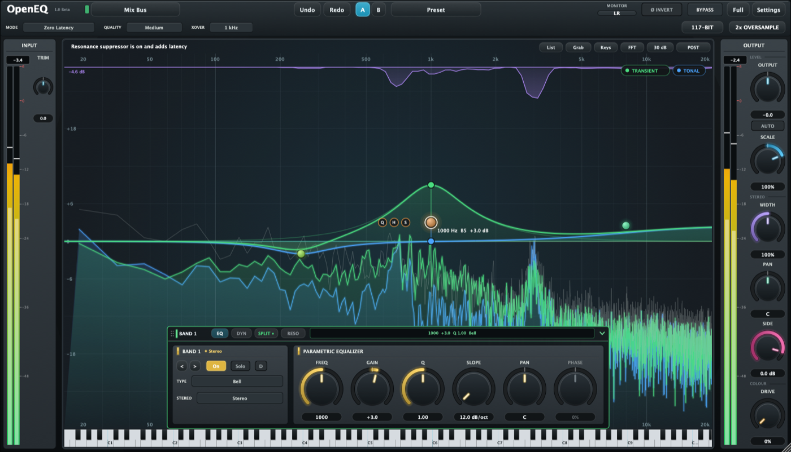
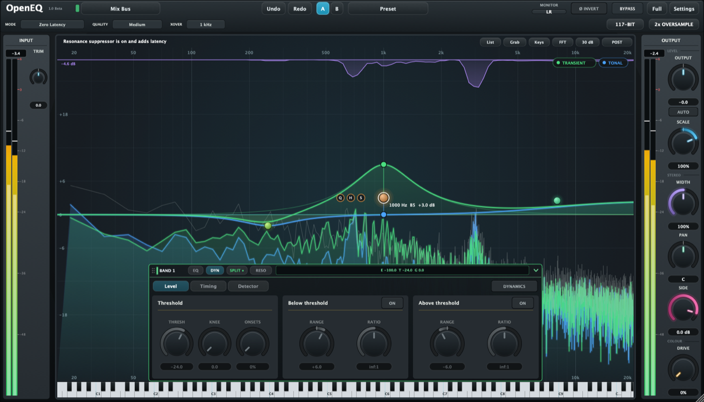
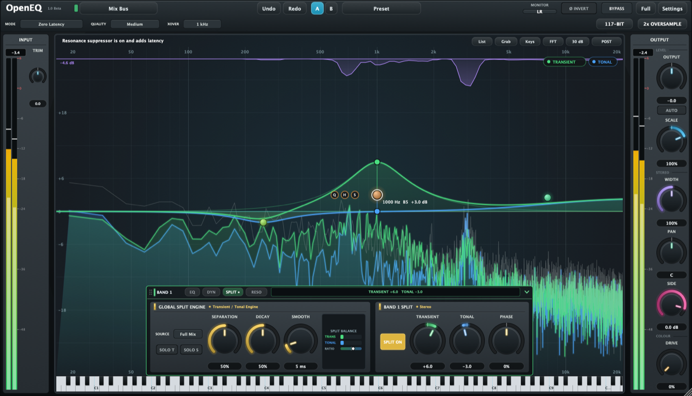
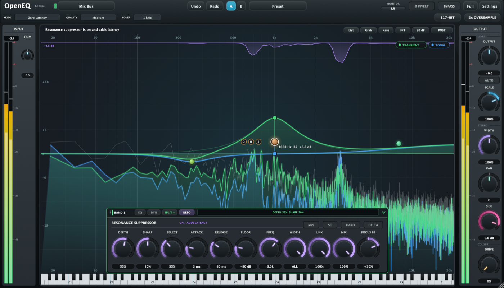
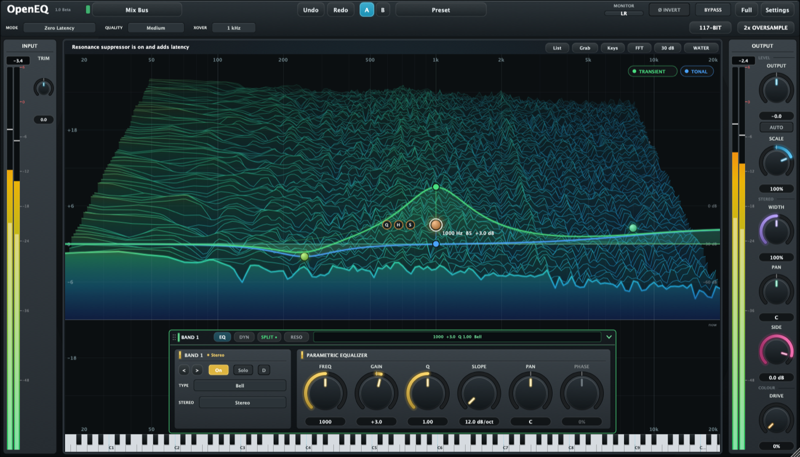
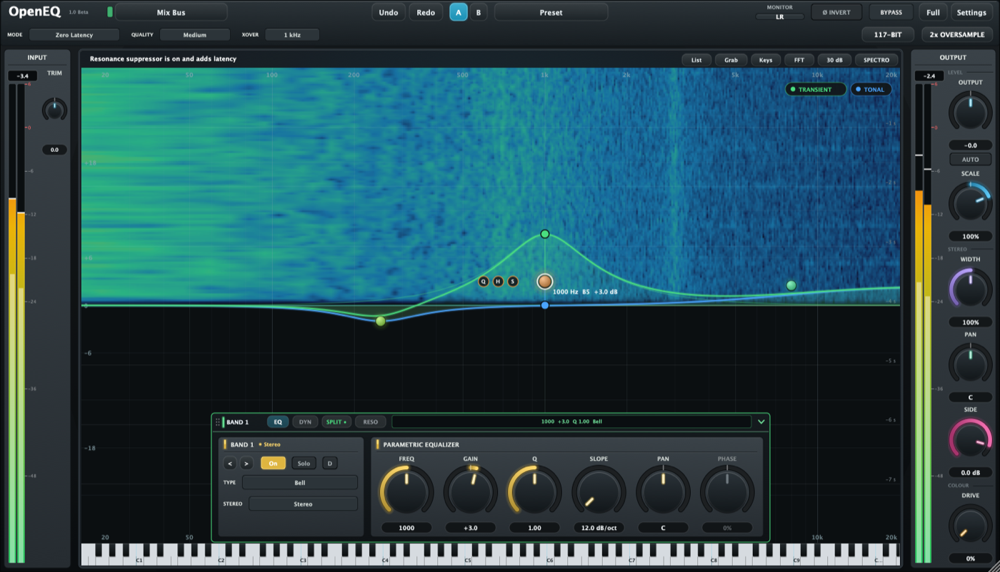
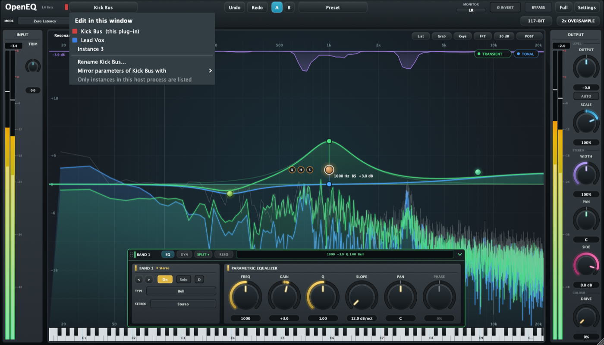

# OpenEQ

**A 32-band parametric, dynamic and linear-phase equalizer with a transient/tonal split and a resonance suppressor.** by OpenGrid



| | | |
|---|---|---|
|  |  |  |
|  |  |  |

## Version 1.0.3 Beta

- Transient/tonal split with per-band stream gains, and a resonance suppressor.
- Six analyzer views, Input Trim, one shared input/output meter with peak hold.
- An INST menu that lists the other OpenEQ instances in the same host process by track name and edits any of them from one window.
- Beta software: see the known issues in [RELEASE_NOTES.md](RELEASE_NOTES.md).

## Download

| Platform | Download | Formats |
|---|---|---|
| macOS 15 or later, universal arm64 + x86_64 | [OpenEQ-1.0.3-macos.pkg](https://github.com/MistaMin/OpenEQ/releases/download/v1.0.3/OpenEQ-1.0.3-macos.pkg) | Audio Unit, VST3, CLAP, LV2, AAX |
| Windows 10 or later, x64 | [OpenEQ-1.0.3-windows-x64-setup.exe](https://github.com/MistaMin/OpenEQ/releases/download/v1.0.3/OpenEQ-1.0.3-windows-x64-setup.exe) | VST3, CLAP, LV2 |
| Linux x86_64 (built on Ubuntu 22.04) | [OpenEQ-1.0.3-linux-x86_64.tar.gz](https://github.com/MistaMin/OpenEQ/releases/download/v1.0.3/OpenEQ-1.0.3-linux-x86_64.tar.gz) | VST3, CLAP, LV2 |

SHA-256 files and the manifest are on the [release page](https://github.com/MistaMin/OpenEQ/releases/tag/v1.0.3).

The macOS installer is signed with a Developer ID and notarized by Apple; its AAX is signed for Pro Tools. The Windows installer is **not code-signed**, so Windows may warn before running it. On Linux, unpack the archive from `/` or copy the plug-in folders to `~/.vst3`, `~/.clap` and `~/.lv2`.

Not in this release: the Standalone app (it has no icon yet). On macOS it has been tested in two hosts and, for AAX, on one mono track in Pro Tools. The Windows and Linux builds are new: they passed automated plug-in validators only and have not been tried in a host.

## User guide

[User manual](docs/USER_MANUAL.md) · [Changelog](CHANGELOG.md) · [Release notes](RELEASE_NOTES.md)

## Features

- 32 bands with bell, shelf, cut, notch, band-pass, tilt, all-pass, and character filter shapes.
- Per-band stereo, left, right, mid, side, and mid/side placement, with solo and pan controls.
- Above/below dynamic EQ with configurable detection, sidechain input, relative detection, timing, and lookahead.
- Transient/tonal splitting: the audio is separated into a transient stream and a tonal stream that add back to the input, and each band has its own gain per stream. Adds about 37 ms of latency while any band is split; Zero Latency mode only.
- Resonance suppressor: turns down only what stands out from its surroundings in the spectrum, so ringing peaks are pulled back while tilt and broad tone are left alone. Independent of input level. Depth, sharpness, selectivity, attack, release, region, stereo link, mix, hard mode and a delta listen. Adds about 43 ms of latency at 48 kHz while on.
- Zero-latency, linear-phase, analogue, mixed-phase, and analogue zero-latency processing modes, with configurable FIR windows and offline render quality.
- Interactive response graph, pre/post/sidechain spectrum analysis, waterfall display, and note keyboard.
- Movable, collapsible inspector with EQ, dynamics, split and suppressor tabs.
- Band management, presets, JSON preset import, theme files, undo/redo, A/B comparison, and an instance switcher that lists the other OpenEQ instances in the same host process by track name and edits any of them from one window.
- Output gain, width, balance, side trim, oversampling, and host automation/state restoration.

## Beta status

Known issues for this release are listed in [RELEASE_NOTES.md](RELEASE_NOTES.md); the changelog is in [CHANGELOG.md](CHANGELOG.md).

This is a development beta. Validation is ongoing across hosts, sample rates, routing configurations, and processing modes. Save your sessions and report reproducible problems with the host version, sample rate, buffer size, and reproduction steps.

Linear-phase processing omits dynamic and all-pass band contributions. Changing FIR quality resets the overlap and may produce a discontinuity. Hosts that isolate plugins into separate processes cannot share the cross-instance registry. See [feature coverage](docs/FEATURE_COVERAGE.md) and [filter validation notes](docs/FILTER_VALIDATION.md) for engineering details and remaining checks.

## Building

Requires CMake 3.22+ and a C++20 compiler. CMake fetches JUCE 8.0.6 automatically.

```sh
cmake -B build -DCMAKE_BUILD_TYPE=Release
cmake --build build --config Release -j
ctest --test-dir build --output-on-failure
```

Build outputs are in `build/OpenEQ_artefacts/Release/{VST3,AU,CLAP,LV2,Standalone}/` (AU on macOS only). Plugin copying after build is on by default; `-DOPENEQ_COPY_PLUGINS=OFF` turns it off. The regression suite builds on macOS only. Windows and Linux release builds run from `.github/workflows/native-builds.yml`.

The measurement tools `response_probe`, `response_compare` and `plugin_probe` (sources in `Tools/`) are not built by default. Configure with `-DOPENEQ_BUILD_PROBES=ON` to build them. `response_probe` requires an explicit `--plugin <VST3 path>` argument.

The regression suite keeps its settings and presets in a temporary folder.

## Repository layout

`Source/` plug-in code, `Source/UI/` controls, `Tests/` regression tests, `Tools/` measurement tools and the manual builder, `docs/` manual and engineering notes, `third_party/` GoodLookinUI.

## License

OpenEQ's own source code is available under the [MIT License](LICENSE), copyright Marcos Quirino Deida. The official binaries are freeware under [BINARY_LICENSE.txt](BINARY_LICENSE.txt). JUCE 8.0.6 is separately licensed under AGPLv3 or a JUCE licence; OpenGrid builds the official binaries under its commercial JUCE licence, and anyone building from source must comply with the JUCE licence that applies to them. GoodLookinUI retains its MIT licence and copyright notices. See [THIRD_PARTY_LICENSES.md](THIRD_PARTY_LICENSES.md).

VST is a trademark of Steinberg Media Technologies GmbH. Audio Units is a trademark of Apple Inc.
