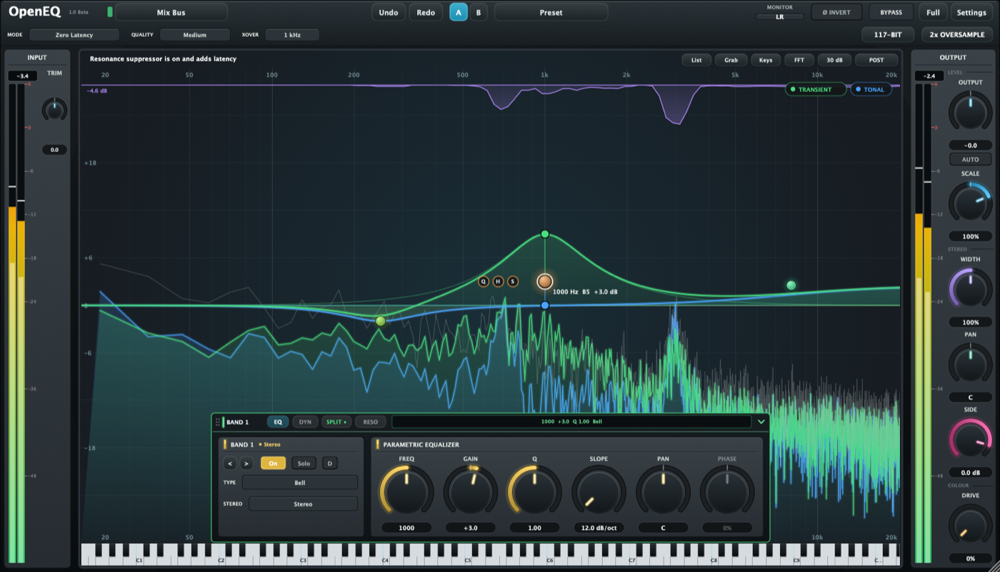
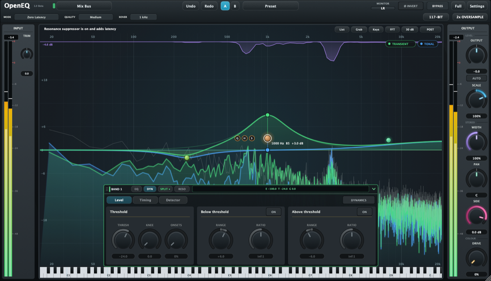
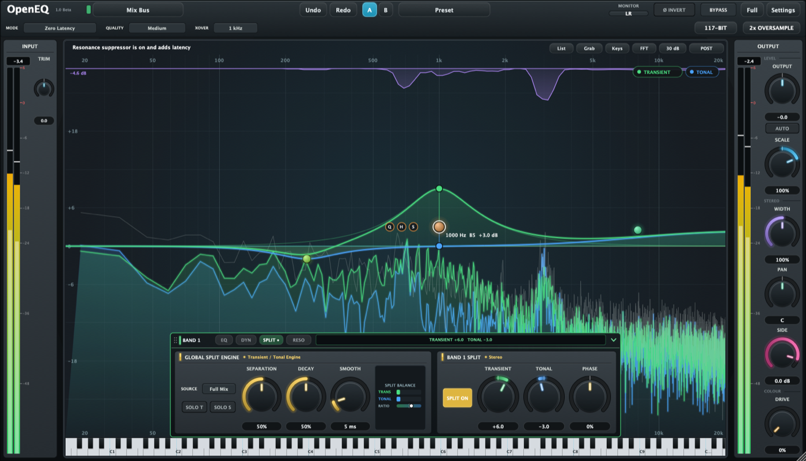
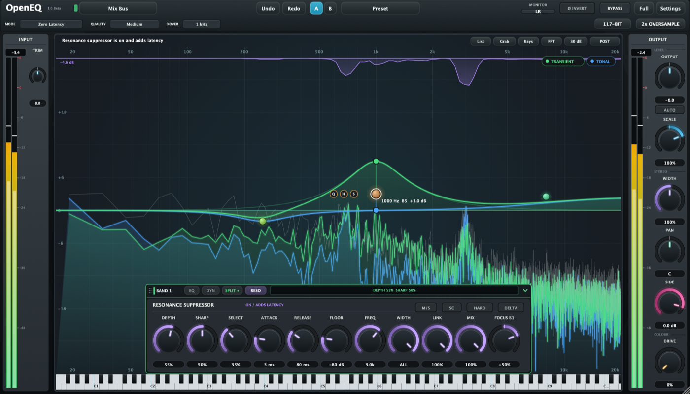
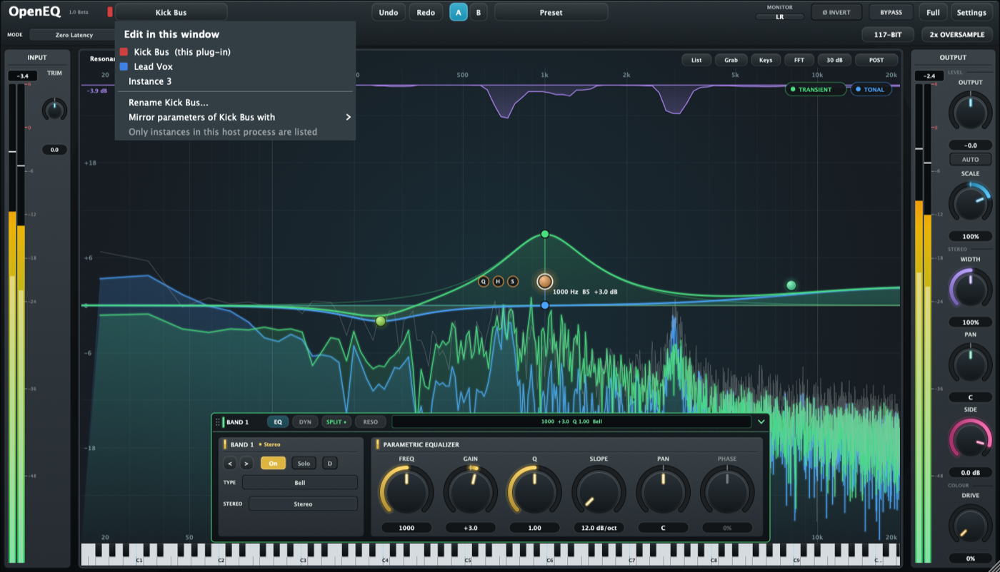

# OpenEQ User Manual

OpenEQ 1.0.3 Beta, by OpenGrid. A parametric and dynamic equalizer with 32 bands, per-band stereo placement, above/below dynamics, a transient/tonal split, a resonance suppressor, and zero-latency, linear-phase, analogue and mixed-phase processing modes.

This manual describes the 1.0.3 Beta build. Every name, range and default below is taken from the source code of that build (the parameter layout in `Source/Parameters.h` and the editor in `Source/`). OpenEQ is a beta: save your sessions often and read Known issues before you rely on it.

## Contents

- Installing and formats
- The window at a glance
- Top bar: instance, undo, A/B, presets, global switches
- Processing modes, latency and linear phase
- The graph: bands, mouse and keys
- Analyzer views and display controls
- Input and output columns, meters
- The floating inspector: EQ, DYN, SPLIT, RESO and the band list
- Instances: the INST menu, switching, renaming and mirroring
- Settings
- Parameter reference: 41 per-band parameters, 42 global parameters
- Host notes
- Known issues
- Licence and trademarks

## Installing and formats

OpenEQ 1.0.3 Beta ships for macOS, Windows and Linux. On macOS it comes as a signed and notarized installer package, `OpenEQ-1.0.3-macos.pkg`, with universal (arm64 and x86_64) plug-ins in five formats:

| Format | Installed to |
|---|---|
| Audio Unit (AU) | `/Library/Audio/Plug-Ins/Components/OpenEQ.component` |
| VST3 | `/Library/Audio/Plug-Ins/VST3/OpenEQ.vst3` |
| CLAP | `/Library/Audio/Plug-Ins/CLAP/OpenEQ.clap` |
| LV2 | `/Library/Audio/Plug-Ins/LV2/OpenEQ.lv2` |
| AAX (Pro Tools) | `/Library/Application Support/Avid/Audio/Plug-Ins/OpenEQ.aaxplugin` |

Run the installer and choose the formats you want. There is no Standalone application in this release (it can be built from source but has no application icon yet), 

**Windows** (10 or later, x64): run `OpenEQ-1.0.3-windows-x64-setup.exe`. It installs VST3, CLAP and LV2 under `C:\Program Files\Common Files`. The installer is not code-signed.

**Linux** (x86_64): `OpenEQ-1.0.3-linux-x86_64.tar.gz` holds VST3, CLAP and LV2 under `usr/lib`. Unpack it from `/`, or copy the folders to `~/.vst3`, `~/.clap` and `~/.lv2`.

The Windows and Linux builds have been checked with automated validators only.

OpenEQ has a stereo main input and output and an optional stereo (or mono) sidechain input named "Sidechain". The sidechain feeds the External detector and relative sources of the dynamics, the SC switch of the resonance suppressor, and the SIDE analyzer view.

## The window at a glance

- **Top bar, first row:** the OpenEQ title and the "1.0.3 Beta" label, the instance button (INST), Undo and Redo, the A and B slots, Preset, then MONITOR, Ø INVERT, BYPASS, Full and Settings.
- **Top bar, second row:** MODE, QUALITY, XOVER on the left; 117-BIT and 2x OVERSAMPLE on the right.
- **Left column (INPUT):** input meter and TRIM.
- **Centre:** the graph with the analyzer behind it. Its top-right corner holds List, Grab, Keys, FFT, the graph range button and the analyzer view button. A notice line at the top left of the graph explains anything temporary or restricted (see below). A piano keyboard runs along the bottom of the graph.
- **Right column (OUTPUT):** output meter and the LEVEL, STEREO and COLOUR groups.
- **Floating inspector:** a movable panel over the graph that holds the selected band's controls and the global sections.

The default window is 1500 x 860 pixels at 100% GUI scale. It can be resized from 1100 x 640 to 1900 x 1200 (both multiplied by the GUI scale). **Full** fills the display and becomes **Window** to return to the previous size; some hosts do not allow plug-in windows to resize.

The notice line can show: "Linear-phase modes leave dynamic bands out", "Linear phase leaves all-pass bands out", "Monitor is temporary and is not saved", "Frequency audition is temporary and is not saved", "Detector listen is temporary and is not saved", "Resonance suppressor is on and adds latency", and "Split needs Zero Latency mode. The linear-phase modes use the band gain alone".

## Top bar: instance, undo, A/B, presets, global switches

| Control | What it does | Saved |
|---|---|---|
| INST (shows the instance name) | Opens the instance menu. See Instances. | Rename is saved |
| Undo / Redo | Undo or redo the last edit made in the graph, the band list, the band menu, the keyboard, a factory preset or a band operation. Keys: Command+Z, Command+Shift+Z or Command+Y (graph focused). | No |
| A / B | Two complete settings slots. Click the slot you want to hear; the lit button is the one playing. Both slots are saved with the session. | Yes |
| Preset | Preset menu (see below). | - |
| MONITOR (LR, L, R, M, S) | Each click cycles the output through stereo, left only, right only, mid, side. It changes what you hear and the analyzer channel. Temporary, not saved; it resets when the last editor window on that instance closes. | No |
| Ø INVERT | Inverts the polarity of the processed output. Bypass is unchanged. | Yes (parameter `polarity`) |
| BYPASS | Bypasses the whole plug-in. | Yes (parameter `bypass`) |
| Full / Window | Fills the display or returns to the previous size. | No |
| Settings | Opens the settings page (see Settings). | Global |
| MODE | Processing mode. | Yes |
| QUALITY | Linear-phase kernel size. | Yes |
| XOVER | Crossover for Mix mode. | Yes |
| 117-BIT | Double-double precision filter state. Costs more CPU. | Yes |
| 2x OVERSAMPLE | Runs the processing at twice the host rate and reports the extra latency. | Yes |

Undo history covers edits made through OpenEQ's own editing actions. Turning a knob or a switch in the inspector or the output column is not recorded in the undo history, and host automation is never undone by OpenEQ. Loading a preset file is not undoable; a factory preset is.

### Presets

The Preset menu has:

- **Init**, **Tilt**, **Presence**: factory presets. Init sets every parameter to its default (bands 1 to 3 on, flat). Tilt adds a Tilt Shelf on band 1 at 800 Hz, +4 dB. Presence adds a Bell on band 1 at 3.5 kHz, +3 dB, Q 0.8. Each starts from Init.
- **User Presets**: the `.opeq` files (and older `.godeq` files) in `~/Library/Application Support/OpenEQ/Presets`.
- **Save Preset...**: saves the current settings as an `.opeq` file.
- **Load Preset...**: loads an `.opeq` or `.godeq` file. A damaged or foreign file reports failure and changes nothing.
- **Import JSON Preset...**: imports a preset stored as JSON with normalised (0 to 1) values. A message lists how many bands were imported and any settings that could not be mapped.
- **Save as Default**: saves the current settings as `default.opeq` in `~/Library/Application Support/OpenEQ`. New instances start from it.
- **Reset to Default**: sets every parameter to its built-in default (the same as Init). It does not load the file saved by Save as Default.

A preset holds the parameters. The instance name and the A/B slot contents of the session are not part of a preset.

## Processing modes, latency and linear phase

MODE has five choices. The default is **Zero Latency**.

| MODE | What it does | Latency |
|---|---|---|
| Zero Latency | Minimum-phase filters (biquads). The only mode that runs dynamic bands, all-pass bands and the transient/tonal split. Digital+ and 117-BIT apply here. | 0 |
| Linear Phase | One linear-phase FIR kernel built from the band curve. | half the kernel |
| Analog | Linear-phase kernel with the magnitude of the analogue prototype (no high-frequency cramping). | half the kernel |
| Mix | Minimum phase below XOVER, linear phase above it. XOVER: 500 Hz, 1 kHz (default), 2 kHz, 4 kHz, 8 kHz. | half the kernel |
| Analog ZL | The analogue prototype rendered as a causal minimum-phase kernel. | 0 |

QUALITY sets the kernel size for every mode except Zero Latency: Low 2048, Medium 4096 (default), High 8192, Maximum 16384 samples. The linear-phase delay is half the kernel: 1024, 2048, 4096 or 8192 samples (about 21, 43, 85 or 171 ms at 48 kHz; half that at 96 kHz).

In every kernel mode (all modes except Zero Latency):

- Dynamic bands and all-pass bands are left out; the notice line says so.
- Split bands use the band gain alone; the transient and tonal gains do nothing.
- Each band's PHASE control works: 0 is linear phase, +1 minimum phase, -1 inverse phase for that band.

Other sources of latency, added together and reported to the host:

| Source | Latency |
|---|---|
| Any band split (Zero Latency mode) | 1791 samples, about 37 ms at 48 kHz |
| Resonance suppressor on (DEPTH above 0%) | 2047 samples at rates up to 50 kHz (about 43 ms at 48 kHz); 4095 up to 100 kHz; 8191 above |
| Lookahead (GLOBAL on, or any dynamic band with BAND AHEAD above 0) | a fixed 20 ms, whatever the time set |
| DRIVE above 0 | the delay of its internal 2x oversampler (small) |
| 2x OVERSAMPLE | the oversampler's delay; the other delays then count at the doubled rate |

When the latency changes, OpenEQ fades the output down, switches, stays silent for the new delay and fades back in, so a mode change while playing gives a short gap. Hosts that compensate plug-in delay re-align automatically; some only do so when playback restarts.

The FFT menu also holds the settings of the FIR kernels and offline rendering:

- **Window shape (FIR)**: Blackman-Harris (default), Kaiser, Hann, Hamming, Blackman, Rectangular.
- **Window tightness**: None (default), 25%, 50%, 75%, Full. Sets the window's tightening parameter (the Kaiser beta or skirt).
- **Render quality (offline)**: Realtime (default: use QUALITY), Low, Medium, High, Maximum. Used only while the host renders offline.
- **Render oversampling (offline)**: Realtime (default: use the 2x OVERSAMPLE switch), Off, 2x. Offline only.
- **Impulse padding**: Short, Normal (default), Full. How much of the windowed impulse is kept.
- **Digital+ steps (IIR phase)**: Off (default), 1, 2, 3, 4. Phase-compensating all-pass steps for the Zero Latency filters.

## The graph: bands, mouse and keys

The graph shows the summed EQ curve over the analyzer, from 20 Hz to 20 kHz. Each used band has a node in its stereo-placement colour. A dynamic band shows a second ring at its current dynamic gain and a readout "E (envelope) T (threshold) R (range) G (gain)" in dB. A split band shows two extra nodes: green for the transient stream, blue for the tonal stream. While a split band is audible, TRANSIENT and TONAL keys at the top right of the graph solo either stream. When an all-pass band is in use a PHASE trace shows its phase response.

32 band slots exist. A band is "used" while it is on or shown in the graph. A new instance starts with bands 1, 2 and 3 on at 0 dB.

Mouse:

- **Double-click empty space:** creates a band in the first free slot at that frequency and gain. Its stereo mode follows the "New band stereo mode" setting.
- **Double-click a node:** type a frequency and gain, for example `2.5k -3` or `800 Hz 4 dB`.
- **Drag a node:** frequency and gain. **Shift** drags at about 15% of the speed. With several bands selected, all move together.
- **Shift+click:** adds a node to the selection.
- **Mouse wheel over a node:** changes Q (bands that use Q). The direction follows the wheel settings.
- **Alt+click and hold a node:** auditions the band while held: you hear a band-pass at its frequency (for a high or low pass, the part it removes).
- **Alt+wheel over empty space:** tilts the analyzer display, -12 to +12 dB per octave around the pivot set in Settings. Display only, not saved.
- **Right-click a node:** the band menu.
- **Ctrl or Command + right-click a node:** removes the band (can be turned off in Settings).
- **Double right-click empty space:** arms or disarms spectrum grab (can be turned off in Settings).
- **Drag a green or blue node:** changes the transient or tonal gain of a split band. Right-click or double-click it to reset it to 0 dB.

Floating controller: around the selected node small handles appear (set in Settings: All, Monitor only, or Off). Drag the **Q** handle up or down to change Q (an octave per 60 pixels, Shift for finer). Drag the **slope** handle to change the slope (the full range over 300 pixels). Hold the **monitor** handle to audition the band. An optional **remove** handle deletes the band.

Keys (graph focused): Command+C copies the selected band, Command+V pastes it (over the selected band or into a free slot), Command+D duplicates it, Delete or Backspace removes the selected bands, Command+Z undo, Command+Shift+Z or Command+Y redo.

Keys (editor window): C or Space opens or closes the inspector, M moves it near the top left of the graph, R puts it back at the bottom centre, 1 EQ, 2 DYN, 3 SPLIT, 4 the band list.

Band menu (right-click a node or a band card): Favourites (if set), Types (grouped by family), Stereo, Enable/Disable, Enable/Disable Dynamic, Invert Gain, Split to Opposite Channel, Copy, Copy In Place, Cut, Remove, Paste, Paste Inverted, Sort by Frequency, Sort by Type, Clear All Bands.

Keys button: shows or hides the piano keyboard under the graph (shown by default). Clicking a key sets the selected band's frequency to that note (A4 = 440 Hz, notes from E0 to D#10).

Grab button: freezes the analyzer. Then drag on empty graph space: OpenEQ finds the nearest spectrum peak and, on release, places a Bell there (Q 2) with the gain you dragged to. The frozen trace is not saved.

## Analyzer views and display controls

The view button at the top right of the graph cycles through six analyzer views. None is saved.

| View | Shows |
|---|---|
| POST | The spectrum after OpenEQ (default). |
| PRE | The spectrum before the EQ (after Input Trim). |
| SIDE | The spectrum of the sidechain input. |
| WATER | A 3D waterfall of recent spectra, newest at the front (about 2.7 s). |
| SPECTRO | A spectrogram, newest row at the top (about 8 s at 30 Hz refresh). |
| SPEC 3D | A 3D spectrogram terrain. |

While the resonance suppressor is on, the analyzer also shows how much it is cutting across the spectrum.

Display controls, global to all instances and not saved:

- **Range button:** graph scale of 12, 18 or 30 dB (default 30 dB).
- **FFT menu, Resolution:** Every bin (default), Pairs of bins, Groups of four, Groups of eight.
- **FFT menu, Speed:** Fast, Medium (default), Slow.
- **FFT menu, Range:** analyzer floor 60, 90 (default) or 120 dB below 0 dBFS.
- **Settings:** Analyzer refresh 15, 30 (default) or 60 Hz; analyzer tilt pivot.

## Input and output columns, meters

Both columns have the same stereo meter: two bars (peak and RMS) with a peak-hold line that holds for about 1.5 s, a scale from +6 dB at the top to -60 dB at the bottom, and a readout on top with the highest peak since it was last cleared. Click the readout or the column header to clear it. The output readout turns red after an overload (and reads CLIP if the number alone would not show it).

The input meter reads the host signal before TRIM, so an overload is visible even when trimming down.

| Column | Control | Range | Default |
|---|---|---|---|
| INPUT | TRIM: input trim before the EQ and the analyzer | -24 to +24 dB, 1 dB steps | 0 dB |
| OUTPUT, LEVEL | OUTPUT: master output gain | -24 to +24 dB | 0 dB |
| OUTPUT, LEVEL | AUTO: auto gain, keeps a similar level after broad boosts or cuts | on/off | off |
| OUTPUT, LEVEL | SCALE: scales every band gain; negative values invert them | -200% to +200% | 100% |
| OUTPUT, STEREO | WIDTH: 0% mono, 100% unchanged, 200% wide | 0% to 200% | 100% |
| OUTPUT, STEREO | PAN: output balance | L100 to R100 | C |
| OUTPUT, STEREO | SIDE: level of the side signal; the bottom of the range (shown "-inf") is silence | -100 to +12 dB | 0 dB |
| OUTPUT, COLOUR | DRIVE: soft saturation (odd tanh, run at 2x). 0 is off and adds no latency | 0 to 100% | 0% |

Every knob: drag up or down to change it, use the mouse wheel, double-click to reset (or to type a value, as set in Settings), or click with the reset modifier (Command by default) to reset. The fine-tune modifier (Shift by default) gives a tenth of the speed.

## The floating inspector: EQ, DYN, SPLIT, RESO and the band list

The inspector floats over the graph, at the bottom centre by default. Drag its header to move it; click the header or its arrow to open or close it. Closed, it is a slim bar that still shows the band number, the field buttons and a one-line readout. Its four field buttons are:

- **EQ:** the selected band. Readout: frequency, gain, Q and type.
- **DYN:** the selected band's dynamics. Readout: E (detected level), T (threshold), G (dynamic gain) in dB. Shows a dot when the band is dynamic.
- **SPLIT:** the global transient/tonal engine and the selected band's split. Readout: TRANSIENT and TONAL gains. Shows a dot when the band is split.
- **RESO:** the resonance suppressor. Readout: DEPTH and SHARP, or SUPPRESSOR OFF.

The **List** button in the graph swaps the inspector body for the band list.

### EQ field

Left card "BAND n" (its accent colour and caption show the stereo placement):

- **< and >** step to the previous or next band slot.
- **On** turns the band on or off. **Solo** solos the band. **D** makes the band dynamic and opens the DYN field; if neither dynamics panel is on, D turns on Above. D is available only for types that have a gain.
- **TYPE** opens the filter type menu, grouped by family. Choosing a cut whose slope is 0 sets it to 12 dB/oct.
- **STEREO**: Stereo, Mid, Side, Left, Right, Mid Side.

Right card, one row of knobs: **FREQ**, **GAIN**, **Q**, **SLOPE** (reads **ATTEN** for the VT LS type), **PAN** and **PHASE**. A knob is dimmed when the band type does not use it: shelves and some modelled types ignore Q; cuts, notch, band pass and all-pass have no gain; PAN works only in Stereo (left/right balance) and Mid Side (how much reaches mid and side); PHASE works only in the kernel modes.

Filter types, in the order of the TYPE menu:

- Top level: Bell, Low Shelf, High Shelf, High Pass, Low Pass, Notch, Band Pass, Tilt Shelf, Flat Tilt, Flat Top, Sword.
- Type E: E HP, E LP, E LS, E HS, E LMF, E HMF, E Low Bell, E High Bell.
- Type G: G LMF, G LS, G HS, G HP, G LP.
- British N: BritN HP, BritN LS, BritN Bell, BritN HS.
- EQ 250: 250 Bell, 250 LS, 250 HS.
- Vintage Tube: VT HP, VT LP, VT LS, VT Boost, VT Atten, VT LMF, VT HMF.
- Tone Stack: Tone Low, Tone High.
- Blue: Blue Low, Blue High.
- Misc: Allpass L, Brickwall HP, Brickwall LP, Allpass H.
- OpenEQ Extras: Soft Bell, Narrow Resonance.

The family types are OpenEQ's own circuit-style curves; some have fixed internal values, so Q or slope may do nothing for them.

### DYN field

A dynamic band moves its gain with the level of a detector signal. The DYN field has three pages, **Level**, **Timing** and **Detector** (the Detector button shows "Detector *" when the detector is not the default), and a **DYNAMICS** switch for the band. The controls are live only when the band is on, dynamic, and of a type with a gain.

Level page:

- **Threshold:** THRESH (shared by Below and Above), KNEE (soft knee width; 0 is a hard threshold), ONSETS (transient weight: higher follows attacks faster).
- **Below threshold** (ON): RANGE (largest gain change below the threshold; the sign sets the direction) and RATIO.
- **Above threshold** (ON): RANGE and RATIO.

RATIO is a percentage. The gain change is the level's distance from the threshold multiplied by RATIO, limited by RANGE. The readout shows it as a ratio: 0% is 1:1 (no change), 50% is 2:1, 75% is 4:1, 100% is inf:1. Values above 100% change the gain by more than the level moved.

Timing page:

- **Envelope:** ATTACK, RELEASE, and AUTO (automatic timing and threshold: 8 ms attack, 140 ms release, threshold 8 dB above the broadband level).
- **Lookahead:** BAND AHEAD (this band looks ahead; any amount above 0 adds a fixed 20 ms of latency), GLOBAL (global lookahead: the audio runs 20 ms late and every dynamic band detects ahead by GLOBAL MS) and GLOBAL MS.

Detector page:

- **Detector filter:** Source (Follow the band's stereo placement, Left, Right, Mid, Side, or External sidechain), LINK (detector follows the band's frequency and Q; turn off to use the detector FREQ and Q), LISTEN (hear the detector band-pass; temporary, not saved), FREQ, Q.
- **Relative detection:** REL (0% compares against nothing; 100% uses only the level relative to the reference), FREE (compare against a band-pass at the relative FREQ and Q instead of the whole signal), Source (Energy, Left, Right, Mid, Side, External), FREQ, Q.

### SPLIT field

The split engine divides the audio into a transient stream and a tonal stream. A split band applies its curve to both streams, each with its own extra gain. Split works only in Zero Latency mode and adds about 37 ms of latency at 48 kHz while any band is split.

Left card, **GLOBAL SPLIT ENGINE**: SOURCE (material preset that scales the separation decision: Full Mix, Drums, Percussive, Instrument, Vocal), SOLO T and SOLO S (hear only the transient or the tonal stream; one at a time), SEPARATION (how much counts as transient), DECAY (how long a region stays transient), SMOOTH (slows the transient/tonal decision), and the **SPLIT BALANCE** meter (TRANS, TONAL and RATIO).

Right card, **BAND n SPLIT**: SPLIT ON, TRANSIENT and TONAL (each added to the band gain; the green and blue nodes in the graph), and PHASE (the same control as in the EQ field).

### RESO field (resonance suppressor)

The suppressor finds narrow resonances and turns them down while they ring. It is off while DEPTH is 0%; above that it runs and adds latency, and the header reads "ON / ADDS LATENCY".

Knobs: DEPTH, SHARP (low makes broad gentle cuts, high narrow deep ones), SELECT (how far a peak must stand out before it is touched), ATTACK (1 ms to 500 ms), RELEASE (20 ms to 2 s), FLOOR (quieter frequencies are left alone), FREQ and WIDTH (centre and width of the processed region; WIDTH 10 reads ALL), LINK (0% treats left and right separately, 100% gives both the deeper cut), MIX (dry/wet), and **FOCUS Bn** for the selected band (above 0 the suppressor works harder around that band's frequency, with a width from its Q; below 0 it works lighter; the band must be on, its gain may stay at 0).

Switches: M/S (detect and cut in mid and side), SC (follow the external sidechain: cut here what stands out there), HARD (no ceiling on the cut; off, cuts level out at a ceiling set by DEPTH), DELTA (hear only what is being removed).

### Band list

The band list shows one card per used band, with its stereo badge (M, S, L, R, MS), frequency, gain, Q and slope. Click a card to select the band, click its power icon to turn it on or off, drag cards to reorder (swap) bands, double-click a value to edit it in the graph, right-click for the band menu, and double-click empty space to add a band.

## Instances: the INST menu, switching, renaming and mirroring

The instance button at the top left shows the name of the instance this window edits. Next to it a small swatch shows the track colour when the host reports one. Click it for the instance menu:

- **Edit in this window:** every OpenEQ instance in the same host process, by name. The instance this window belongs to is marked "(this plug-in)"; the instance being edited is ticked. Choose another instance and this window edits it: every control, the graph and the meters then belong to that instance. The button then reads "EDITING name" and lights up. Choose "(this plug-in)" to go back. If the instance being edited is removed, the window returns to its own instance.
- **Rename name...:** names the instance being edited. The name is shown in the instance menu of every OpenEQ window and is saved with the session, but not in presets or A/B slots. Leave it empty to go back to the track name.
- **Mirror parameters of name with:** links this window's own instance with another one, both ways. Every parameter edit or automation on either side is copied to the other. Choose **Off** to unlink. The link ends automatically when the other instance is removed. The link itself is not saved with the session.

Names: OpenEQ uses the name you typed with Rename first, then the track name the host reports, then "Instance N". Duplicate names get " (2)" and so on. Hosts that do not send track names (some Audio Unit hosts) show "Instance N"; use Rename there.

Only instances in the same host process are listed ("Only instances in this host process are listed"). A host that runs each plug-in in its own process, or in a separate sandbox, cannot show other instances; the menu then reads "No other OpenEQ instance in this process. Hosts that run each plug-in in its own process cannot show them here." and the mirror submenu is not shown.

## Settings

Settings are global: they apply to every OpenEQ instance and are stored for your user account, not in the session. **Reset Settings** restores the defaults, **Restore Size** sets the window back to 1500 x 860 (times the GUI scale), **Close** returns to the plug-in.

| Setting | Choices | Default |
|---|---|---|
| Reverse mouse wheel direction on knobs and the graph | on/off | off |
| Fine-tune modifier | None, Shift, Ctrl, Alt, Command | Shift |
| Wheel invert modifier (reverses the wheel) | None, Shift, Ctrl, Alt, Command | Command |
| Click knob to reset with | None, Shift, Ctrl, Alt, Command | Command |
| Double-click on a knob | Reset to default, Type a value | Reset to default |
| Ctrl/Command + right-click on a band deletes it | on/off | on |
| Double right-click on empty graph enables spectrum grab | on/off | on |
| New band stereo mode | Always last created, By selection, Always default | Always last created |
| Default stereo mode | the six stereo modes | Stereo |
| Knob drag speed / Knob wheel speed | 25% to 400% | 100% |
| Frequency, Gain, Q drag speed and wheel speed | 10% to 400% | 100% |
| Gain knob limited to the displayed dB range | on/off | off |
| Gain knob speed follows the displayed dB range | on/off | off |
| Show band numbers on the graph | on/off | off |
| Show cursor axes with frequency and gain | on/off | off |
| Spectrum centre frequency (analyzer tilt pivot) | 20 Hz to 20 kHz | about 548 Hz |
| Show a remove button on the floating band controller | on/off | off |
| Show readout for the selected band | on/off | on |
| Floating band controller | All, Monitor only, Off | All |
| Analyzer refresh | 15, 30, 60 Hz | 30 Hz |
| GUI scale | 80%, 90%, 100%, 110%, 125%, 150% | 100% |
| Theme | Graphite, Light, High contrast | Graphite |
| Save current colours as a theme file... / Load theme file (.opeq_theme)... | file | - |
| Favourite types (shown first in the band menu) | any filter types | none |

## Parameter reference

OpenEQ exposes 1,354 parameters to the host: 41 for each of the 32 bands (1,312) and 42 global ones. Hosts list them by name, such as "Band 1 Frequency".

### Per-band naming

Band parameter IDs are `bN_suffix`, where N counts from **0**: band 1 is `b0_`, band 32 is `b31_`. Host names count from 1: "Band 1 ..." to "Band 32 ...". For example, band 5's frequency has the ID `b4_freq` and the name "Band 5 Frequency".

### The 41 per-band parameters

Default frequency: band n starts at 60 Hz x 1.75^(n-1), limited to 20 kHz (band 1 60 Hz, band 2 105 Hz, band 3 184 Hz, band 4 322 Hz, ... band 11 16.2 kHz, bands 12 to 32 20 kHz). Bands 1 to 3 start on and shown; the others start off.

| ID suffix | Host name ("Band n ...") | Control | Range | Default |
|---|---|---|---|---|
| `_active` | Active | EQ: On | on/off | on for bands 1-3, else off |
| `_type` | Type | EQ: TYPE | 48 types (see the EQ field) | Bell |
| `_freq` | Frequency | EQ: FREQ, graph node | 20 Hz to 20 kHz | see above |
| `_gain` | Gain | EQ: GAIN, graph node | -30 to +30 dB | 0 dB |
| `_q` | Q | EQ: Q, wheel, Q handle | 0.025 to 40 | 1.0 |
| `_slope` | Slope | none (old sessions only) | 6, 12, 24, 36, 48, 72, 96 dB/oct | 12 dB/oct |
| `_stereo` | Stereo Mode | EQ: STEREO | Stereo, Mid, Side, Left, Right, Mid Side | Stereo |
| `_solo` | Solo | EQ: Solo | on/off | off |
| `_dynOn` | Dynamic On | EQ: D; DYN: DYNAMICS | on/off | off |
| `_dynThresh` | Dyn Threshold | DYN Level: THRESH | -60 to 0 dB, 1 dB steps | -24 dB |
| `_dynRange` | Dyn Range | none (old sessions only) | -30 to +30 dB | +6 dB |
| `_dynAtk` | Dyn Attack | DYN Timing: ATTACK | 1 to 500 ms | 15 ms |
| `_dynRel` | Dyn Release | DYN Timing: RELEASE | 1 to 2000 ms | 150 ms |
| `_shown` | Shown | none (set by creating and removing bands) | on/off | as `_active` |
| `_dynAct` | Dyn Action | none (old sessions only) | Above, Below | Above |
| `_dynKnee` | Dyn Knee | DYN Level: KNEE | 0 to 24 dB | 0 dB |
| `_dynSrc` | Dyn Source | DYN Detector: Source | Follow, Left, Right, Mid, Side, External | Follow |
| `_dynBlend` | Dyn Relative | DYN Detector: REL | 0% to 100% | 0% |
| `_dynAhead` | Dyn Lookahead | DYN Timing: BAND AHEAD | 0 to 20 ms | 0 ms |
| `_dynTrans` | Dyn Transient | DYN Level: ONSETS | 0% to 100% | 0% |
| `_dynAuto` | Dyn Auto | DYN Timing: AUTO | on/off | off |
| `_dynDetLink` | Dyn Detector Link | DYN Detector: LINK | on/off | on |
| `_dynDetFreq` | Dyn Detector Frequency | DYN Detector: FREQ | 20 Hz to 20 kHz | the band's default frequency |
| `_dynDetQ` | Dyn Detector Q | DYN Detector: Q | 0.025 to 40 | 1.0 |
| `_dynBelowOn` | Dyn Below On | DYN Level: Below ON | on/off | off |
| `_dynBelowRange` | Dyn Below Range | DYN Level: Below RANGE | -30 to +30 dB | +6 dB |
| `_dynBelowRatio` | Dyn Below Ratio | DYN Level: Below RATIO | 0% to 200% | 100% (inf:1) |
| `_dynAboveOn` | Dyn Above On | DYN Level: Above ON | on/off | off |
| `_dynAboveRange` | Dyn Above Range | DYN Level: Above RANGE | -30 to +30 dB | -6 dB |
| `_dynAboveRatio` | Dyn Above Ratio | DYN Level: Above RATIO | 0% to 200% | 100% (inf:1) |
| `_dynRelFree` | Dyn Relative Free | DYN Detector: FREE | on/off | off |
| `_dynRelFreq` | Dyn Relative Frequency | DYN Detector: relative FREQ | 20 Hz to 20 kHz | the band's default frequency |
| `_dynRelQ` | Dyn Relative Q | DYN Detector: relative Q | 0.025 to 40 | 1.0 |
| `_dynRelSrc` | Dyn Relative Source | DYN Detector: relative Source | Energy, Left, Right, Mid, Side, External | Energy |
| `_pan` | Pan | EQ: PAN | L100 to R100 (-100 to +100) | C (0) |
| `_slopeN` | Slope | EQ: SLOPE / ATTEN, slope handle | 0 to 1 (see below) | 0 |
| `_splitOn` | Split On | SPLIT: SPLIT ON | on/off | off |
| `_splitTrans` | Split Transient Gain | SPLIT: TRANSIENT, green node | -30 to +30 dB | 0 dB |
| `_splitTail` | Split Tail Gain | SPLIT: TONAL, blue node | -30 to +30 dB | 0 dB |
| `_phase` | Phase | EQ and SPLIT: PHASE | -1 to +1 (shown as %) | 0 (linear) |
| `_suppress` | Suppressor Focus | RESO: FOCUS Bn | -100% to +100% | 0% |

Slope (`_slopeN`) is a normalised 0 to 1 control that sets the filter order. For bells, shelves and notches the readout runs 12 dB/oct at 0, 24 at 0.5, 48 at 0.75 and 96 at 1. For cuts and band pass, 0 is off, 0.5 is 12 dB/oct, 0.75 is 48 and 1 is 96 dB/oct. Typing a number above 1 into the SLOPE knob reads it as dB/oct. For the VT LS type the same control is an attenuation amount (ATTEN).

### The 42 global parameters

| ID | Host name | Control | Range | Default |
|---|---|---|---|---|
| `processingMode` | Processing Mode | MODE | Zero Latency, Linear Phase, Analog, Mix, Analog ZL | Zero Latency |
| `linearPhaseQuality` | Linear Phase Quality | QUALITY | Low, Medium, High, Maximum | Medium |
| `outputGain` | Output Gain | OUTPUT | -24 to +24 dB | 0 dB |
| `stereoWidth` | Stereo Width | WIDTH | 0% to 200% | 100% |
| `bypass` | Bypass | BYPASS | on/off | off |
| `polarity` | Polarity Invert | Ø INVERT | on/off | off |
| `autoGain` | Auto Gain | AUTO (output) | on/off | off |
| `drive` | Drive | DRIVE | 0 to 1 (0% to 100%) | 0 |
| `spectralAmount` | Spectral Amount | RESO: DEPTH | 0% to 100% | 0% (off) |
| `spectralThresh` | Spectral Floor | RESO: FLOOR | -100 to 0 dB | -80 dB |
| `spectralFreq` | Spectral Frequency | RESO: FREQ | 20 Hz to 20 kHz | 3 kHz |
| `spectralOct` | Spectral Width | RESO: WIDTH | 0.1 to 10 octaves (10 = ALL) | 10 (ALL) |
| `spectralSharp` | Spectral Sharpness | RESO: SHARP | 0% to 100% | 50% |
| `spectralSelect` | Spectral Selectivity | RESO: SELECT | 0% to 100% | 35% |
| `spectralAttack` | Spectral Attack | RESO: ATTACK | 0 to 1, shown as 1 ms to 500 ms | 0.2 (about 3 ms) |
| `spectralRelease` | Spectral Release | RESO: RELEASE | 0 to 1, shown as 20 ms to 2 s | 0.3 (about 80 ms) |
| `spectralMix` | Spectral Mix | RESO: MIX | 0% to 100% | 100% |
| `spectralLink` | Spectral Stereo Link | RESO: LINK | 0% to 100% | 100% |
| `spectralHard` | Spectral Hard Mode | RESO: HARD | on/off | off |
| `spectralDelta` | Spectral Delta | RESO: DELTA | on/off | off |
| `spectralMS` | Spectral Mid/Side | RESO: M/S | on/off | off |
| `spectralSidechain` | Spectral Sidechain | RESO: SC | on/off | off |
| `gainScale` | Gain Scale | SCALE | -200% to +200% | 100% |
| `sideGain` | Side Level | SIDE | -100 dB (silence) to +12 dB | 0 dB |
| `outputPan` | Output Pan | PAN (output) | L100 to R100 (-100 to +100) | C (0) |
| `ultraPrecision` | 117-bit Precision | 117-BIT | on/off | off |
| `mixCrossover` | Mix Crossover | XOVER | 500 Hz, 1 kHz, 2 kHz, 4 kHz, 8 kHz | 1 kHz |
| `oversample2x` | 2x Oversampling | 2x OVERSAMPLE | on/off | off |
| `lookaheadOn` | Lookahead | DYN Timing: GLOBAL | on/off | off |
| `lookaheadMs` | Lookahead Time | DYN Timing: GLOBAL MS | 0 to 20 ms | 0 ms |
| `splitSource` | Split Source | SPLIT: SOURCE | Full Mix, Drums, Percussive, Instrument, Vocal | Full Mix |
| `splitSeparation` | Transient Separation | SPLIT: SEPARATION | 0% to 100% | 50% |
| `splitDecay` | Transient Decay | SPLIT: DECAY | 0% to 100% | 50% |
| `splitSmoothingMs` | Split Smoothing | SPLIT: SMOOTH | 0 to 50 ms | 5 ms |
| `splitSolo` | Split Solo | SPLIT: SOLO T / SOLO S; graph TRANSIENT / TONAL keys | Off, Transient, Tonal | Off |
| `windowShape` | Window Shape | FFT menu: Window shape (FIR) | Blackman-Harris, Kaiser, Hann, Hamming, Blackman, Rectangular | Blackman-Harris |
| `windowParameter` | Window Parameter | FFT menu: Window tightness | 0 to 1 (menu: None, 25%, 50%, 75%, Full) | 0 (None) |
| `renderQuality` | Render Quality | FFT menu: Render quality (offline) | Realtime, Low, Medium, High, Maximum | Realtime |
| `renderOversample` | Render Oversampling | FFT menu: Render oversampling (offline) | Realtime, Off, 2x | Realtime |
| `impulsePadding` | Impulse Padding | FFT menu: Impulse padding | Short, Normal, Full | Normal |
| `digitalPlus` | Digital+ Steps | FFT menu: Digital+ steps (IIR phase) | Off, 1, 2, 3, 4 | Off |
| `inputGain` | Input Trim | INPUT: TRIM | -24 to +24 dB, 1 dB steps | 0 dB |

Not parameters, and not saved: MONITOR, frequency audition, detector LISTEN, the analyzer view, the graph range, the FFT display settings, the analyzer tilt, Grab and the Keys strip.

## Host notes

- **Formats:** Audio Unit and VST3 on macOS 64-bit hosts. Standalone is not part of this release.
- **Latency:** OpenEQ reports its latency to the host every time it changes (see Processing modes). Hosts that compensate plug-in delay need that to stay aligned; some hosts apply a new latency only when playback restarts.
- **Sidechain:** route a mono or stereo signal to the "Sidechain" input to use External detection, the suppressor's SC switch and the SIDE view. With host double precision the external sidechain is not used (see Known issues).
- **Offline rendering:** Render quality and Render oversampling apply only when the host renders offline. Leave both on Realtime to render exactly what you hear.
- **2x OVERSAMPLE** re-prepares the plug-in; in this beta it takes effect when playback starts.
- **Window size:** some hosts do not let plug-in windows resize or go full screen. Use the GUI scale setting instead.
- **Track names:** the instance menu uses the track name and colour when the host reports them. Not every host does, and some Audio Unit hosts do not; use Rename there.
- **Process isolation:** hosts that run each plug-in in its own process (or sandbox) cannot list other instances in the INST menu, and mirroring is then not available.
- **Automation:** all 1,354 parameters can be automated. Automation is not recorded in OpenEQ's undo history.

## Known issues

These are known in OpenEQ 1.0.3 Beta (the same list as the release notes, plus one display fault found while writing this manual):

- Sessions saved by builds from before the public 0.3.0-beta source can be misread by hosts that identify parameters by position (the band parameter block grew during development). Sessions from 0.3.0-beta load unchanged.
- A suppressor threshold saved by an older version is read as a floor and can leave the suppressor silent until the FLOOR control is reset.
- Impulse Padding, Dyn Knee (with the Above/Below panels) and the 2x Oversampling control have no effect while playing; oversampling is read only when playback starts.
- With host double precision, the external sidechain is not used.
- Auto Gain can step by several dB within a few samples when a band gain changes.
- The WATER and SPEC 3D views can take longer to draw than the display update interval at large window sizes.
- With split or lookahead on, the suppressor's sidechain key runs slightly early.
- Some tooltips do not match the control ranges (for example OUTPUT and SIDE say -30 to +30 dB and SCALE says 0% to 200%; the ranges in this manual are the real ones). The default Output Gain can read "-0.0".
- The RMS and input level bars depend on the host buffer size.
- Automated validators can time out under heavy machine load; raise their time limit.
- The mirror (link) part of the instance menu, other hosts' track-name behaviour, native popups with a real mouse, the Standalone launch and old projects in a real host were not covered by testing. Where a host sends no track names, use Rename.
- Nobody has yet listened to the newer audio paths in a long session.

Please report reproducible problems with the host name and version, the sample rate, the buffer size and the steps that reproduce them.

## Licence and trademarks

Copyright (c) 2026 Marcos Quirino Deida.

- **Source code:** OpenEQ's source code is available under the MIT License (`LICENSE`).
- **Official binaries:** the official compiled OpenEQ plug-ins and installers are freeware under the OpenEQ Binary Freeware License (`BINARY_LICENSE.txt`). You may use them free of charge, including for commercial work, under the terms in that file.
- **Third-party components:** OpenEQ is built with third-party libraries under their own licences. They are listed with their licence texts in `THIRD_PARTY_LICENSES.md`, which ships with every release.

VST is a trademark of Steinberg Media Technologies GmbH. Audio Units is a trademark of Apple Inc. macOS is a trademark of Apple Inc. All other trademarks are the property of their respective owners.
